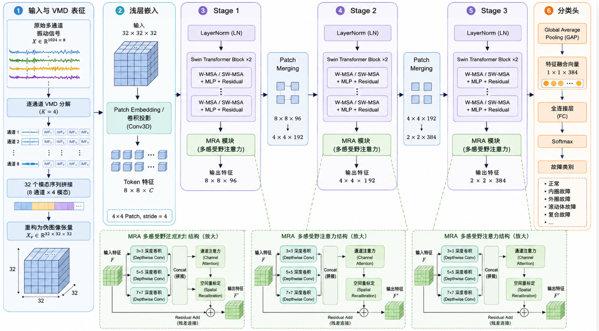

# VMD-MRASwinNet: A VMD Modal Reliability Attention Swin Transformer for Fault Diagnosis of Multi-source Vibration Information Fusion

Preface  
\tIn the task of mechanical fault diagnosis, vibration signals often originate from multiple measurement points, in different directions, or through multiple sensor channels. The fault responses contained by different channels are not entirely consistent: some channels are more sensitive to local impacts, others reflect low-frequency fluctuations within the structural transmission path, and still others are more susceptible to background noise or installation location effects. Therefore, how to fully utilize the complementary information in multi-channel vibration signals is an important issue for improving fault diagnosis performance.  
\tTraditional methods typically directly input raw multi-channel signals into CNNs, LSTMs, or Transformers for classification. Although they enable end-to-end learning, there are two problems:  
\tFirstly, the raw signals are highly non-stationary, with components of faults at different frequencies easily mixing;  
\tSecondly, the contribution differences between multiple sources and modalities are not explicitly modeled, making the model treat all input channels as equally important features.  
\tTo address this, we propose a novel fault diagnosis network for multi-source vibration signals based on VMD mode reliability attention and sequential folding Swin Transformer: VMD-MRASwinNet.  
\t  
\tThe model takes multi-channel vibration signals as input, first performs VMD decomposition on each sensor channel, breaking down the original signal into multiple narrow-band modal components; then reconstructs different sensors and modal components into a VMD mode reliability folding map; on this basis, introduces a sensor-modality embedding mechanism and a mode reliability attention module to achieve adaptive fusion of multi-sensor, multi-band, and multi-modal information; finally uses the window attention mechanism of Swin Transformer to extract local impact textures and cross-window discriminative features, completing fault classification.  
\t(Suitable for signal classification tasks involving multiple sensors and multiple feature columns)  
● Dataset: Southeast University bearing fault dataset
Environmental Framework: Python 3.10, PyTorch 2.1 and above are compatible for execution.
Accuracy: 100% accuracy on the test set.
Usage Objects: For those requiring papers or graduation projects.
Code Guarantee: The code is detailed with comments, ready to run without modification.
Model Process Overview:
\t1.1 Core Process of the Model
The core idea of VMD-MRASwinNet is:
\tTreating multi-channel vibration signals as multi-source information inputs, and different sensor modality after VMD decomposition as multi-source modality features. Through modality reliability attention and Swin Transformer, it realizes adaptive enhancement, fusion, and classification recognition of multi-source information.

The overall process of the model is as follows:
\tRaw 8-channel vibration signal \t[B, 1024, 8]\t -> \tChannel by channel VMD decomposition, each channel decomposed into 4 modalities -> \tMulti-source VMD modal sequence \t[B, 1024, 32]\t -> \tTemporal folding graph construction \t[B, 32, 32, 32]\t
Sensor-modality embedding SME -> \tModality reliability attention MRA -> \tLocalized impact enhancement Stem
Swin Transformer hierarchical window attention modeling -> \tGlobal average pooling + classification head -> \tFault category output
From an information fusion perspective, the model simultaneously integrates three types of information:
① Multi-sensor information: from 8 original vibration channels;
② Multi-modality information: each channel decomposed into 4 modalities after VMD;
③ Multi-local area information: modeled by Swin Transformer local window and cross-window relationships after temporal folding.
Therefore, VMD-MRASwinNet is not a simple VMD + Swin Transformer, but a modality-level information fusion network for multi-source vibration signals.
\t1.2 Multi-source feature signal VMD decomposition
For multi-source fault vibration signals, the Variational Mode Decomposition (VMD) is first applied to decompose the raw feature signal into multiple modes. This process effectively separates complex signals into several Intrinsic Mode Functions (IMFs), capturing the local time-frequency characteristics of the signal. Additionally, VMD has good noise suppression capabilities, providing a more pure and discriminative input for subsequent feature extraction.
1.3 Model innovation points
1. Innovation Point One: Proposal of VMD Modal Fusion Representation for Multi-Source Vibration Signals
Innovation Point Three: Proposal of Modal Reliability Attention, Achieving Multi-Source Modal Adaptive Screening
Innovation Point Four: Utilizing Swin Transformer for Multi-Source Modality Image Window Fusion Modeling
3. Preprocessing of multi-source bearing fault data
3.1 Import Data
The Southeast University dataset is primarily divided into two categories: bearing datasets and gearbox datasets. Each type of fault corresponds to these two working conditions (rotational speed at 20Hz (1200rpm) - load at 0V (0Nm), and rotational speed at 30Hz (1800rpm) - load at 2V (7.32Nm)), respectively corresponding to the gearset and bearingset folders.

The bearing dataset (5 types):
- Ball fault
- Inner ring fault
- Outer ring fault
- Combination fault on both inner ring and outer ring
- Normal working state

We will preprocess this 5-class bearing dataset for explanation purposes, with a dataset of 8 channels!

3.2 VMD Decomposition and Preprocessing

Decomposition visualization:
Due to the large volume of data, we take a part of the data as an example, create a dataset through sliding windows, and divide it into training set, validation set, and test set uniformly at 7:2:1. Finally, save the data. The distribution of the completed dataset is as follows:

4. Based on VMD-MRASwinNet feature fusion for fault diagnosis model
4.1 Define the network model
4.2 Set parameters and train the model
Training for 50 epochs, achieving 100% accuracy with VMD-MRASwinNet feature fusion network classification, significantly improving from multi-source fault signal features to extract important features for model recognition.
4.3 Model evaluation
(1) Accuracy, Precision, Recall, F1 Score
(2) Fault 5-class confusion matrix:
(3) Classification label visualization
(4) Original Data t-SNE Feature Visualization
(5) Post-Training t-SNE Feature Visualization:
VMD-MRASwinNet achieves adaptive fusion and high-discriminative classification of multi-source fault information in multi-channel vibration signals through VMD multimodal decomposition, multi-source modality fusion representation, sensor-modality embedding, modality reliability attention, local impact enhancement, and Swin Transformer window modeling. It is a fault diagnosis model that combines signal processing priors, deep feature learning capabilities, and modality interpretability.
Click to download: Full original data, Python code
Previously interesting content:
Python Bear Fault Diagnosis (19) Innovative Diagnosis Model Based on Transformer-BiLSTM
END

## Images

<!-- PAYMENT_BLOCK -->

## Get this dataset

- Payment link (Stripe): [Buy now](https://buy.stripe.com/3cs8yP7sY87d0vu9AB)
- Payment QR code: 

<!-- /PAYMENT_BLOCK -->
